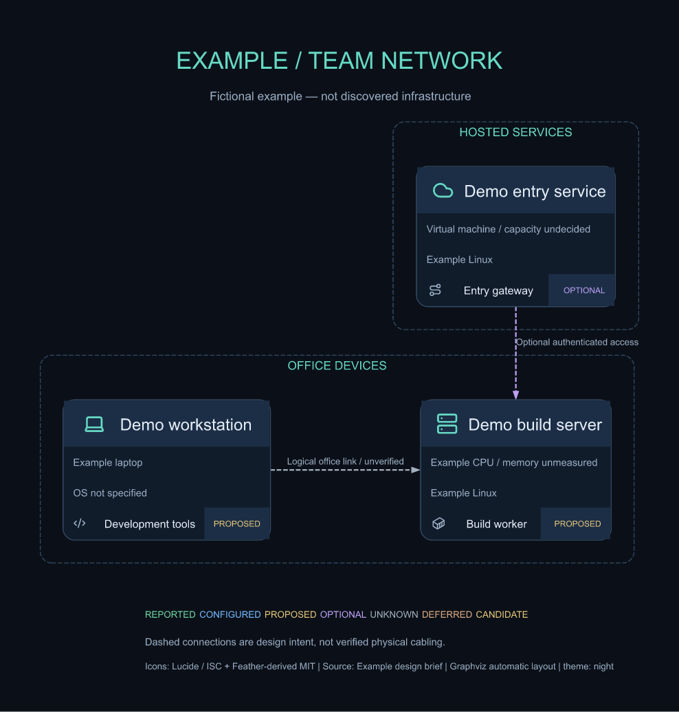

# Network Diagram Skill

Draw network and homelab diagrams from a YAML inventory, with automatic layout,
per-device service cards, night/paper themes and offline Lucide icons.



**Inspired by [Goblinmine/homelab-diagram](https://github.com/Goblinmine/homelab-diagram).**
Thank you to Goblinmine for sharing the original r/homelab-style presentation.
Icons are by [Lucide](https://lucide.dev/), packaged by
[Iconify](https://iconify.design/), with some artwork derived from
[Feather](https://feathericons.com/). See [CREDITS.md](CREDITS.md) for attribution
and dependency acknowledgements.

## Install

Requires Node.js 22+ and npm. Install the complete skill with the skills CLI:

```shell
npx skills add phillui-37/network-diagram-skill --skill network-diagram --global --agent codex --copy --yes
```

The shared installation is ~/.agents/skills/network-diagram. Alma can discover
this complete directory too. Use your own supported --agent value for another
client. --copy avoids relying on directory links for discovery. After installation:

```powershell
$skill = Join-Path $HOME '.agents/skills/network-diagram'
npm.cmd --prefix $skill ci --no-audit --no-fund
Copy-Item "$skill/examples/inventory.yaml" ./inventory.yaml
node "$skill/scripts/render.mjs" --inventory ./inventory.yaml --out ./network
node "$skill/scripts/render.mjs" --inventory ./inventory.yaml --out ./network --check
```

On shells using the standard npm entry point, use npm instead of npm.cmd. Keep the
whole package: SKILL.md alone does not contain the renderer or dependencies.
Do not copy node_modules across operating systems; run npm ci on the target host.

## Use

Ask your agent to use network-diagram with your project's design or inventory.
[SKILL.md](SKILL.md) is its entry point. Device names, service placement and
connection intent belong to the inventory; the renderer assumes no specific
machines, addresses or topology. Copy [the fictional example](examples/inventory.yaml)
as a starting point and replace its contents with documented project facts.

Input/output paths resolve from the caller's working directory. Both --inventory
and --out are required; the output directory must exist. SVG and PNG are generated
together. Use --theme paper for the light palette and --help for arguments.
[references.md](references.md) describes the schema and optional layout constraints.

Icons are embedded in SVG; rendering and viewing need no icon CDN after npm ci.
--check normalizes SVG line endings and compares PNG bytes in the same font
environment. Fonts can change PNG output between machines. Windows execution is
verified; other operating systems have not been executed for this publication.

## Develop

```shell
npm ci --no-audit --no-fund
npm test
node scripts/render.mjs --inventory examples/inventory.yaml --out docs/example
```

Tests invoke the real CLI using arbitrary project names and another working
directory, exercise both themes and embedded icons, check CRLF handling and reject
unknown layout references. The example contains no real deployment information.

## License and credit

Project code is [MIT licensed](LICENSE). Lucide icons carry ISC and, for
Feather-derived icons, MIT notices retained in [assets/ICONS-LICENSE.txt](assets/ICONS-LICENSE.txt)
and generated SVG metadata. Keep those notices with shared raster exports.
Visual inspiration: [Goblinmine/homelab-diagram](https://github.com/Goblinmine/homelab-diagram).
